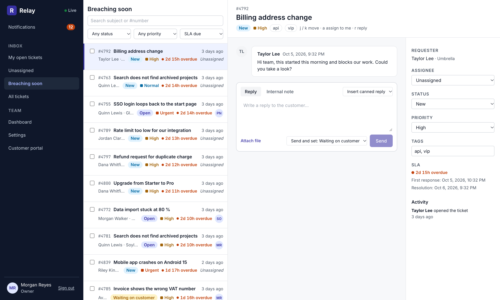
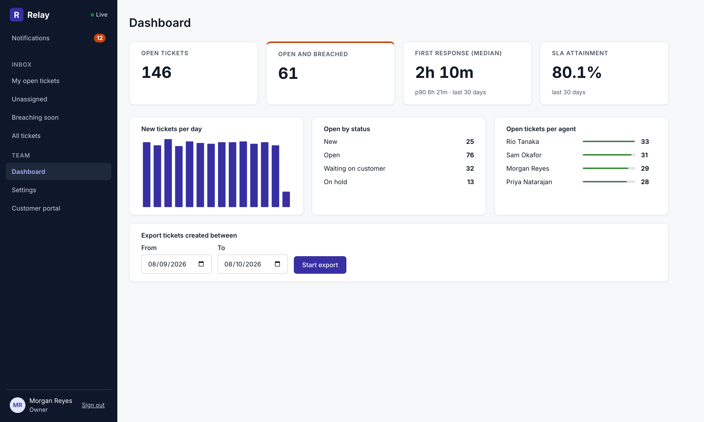
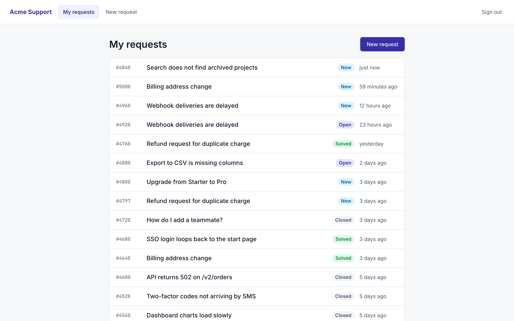
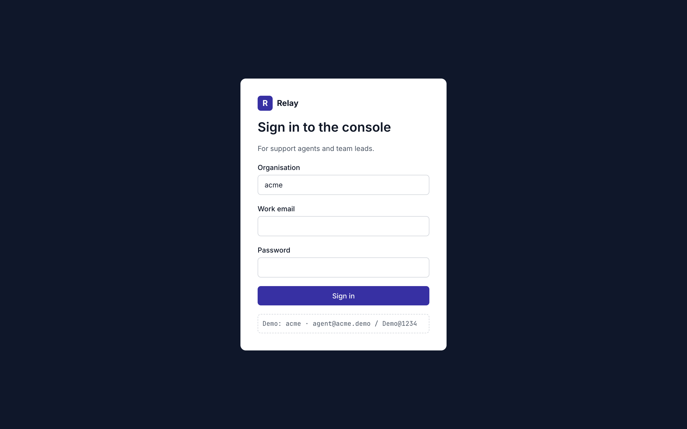
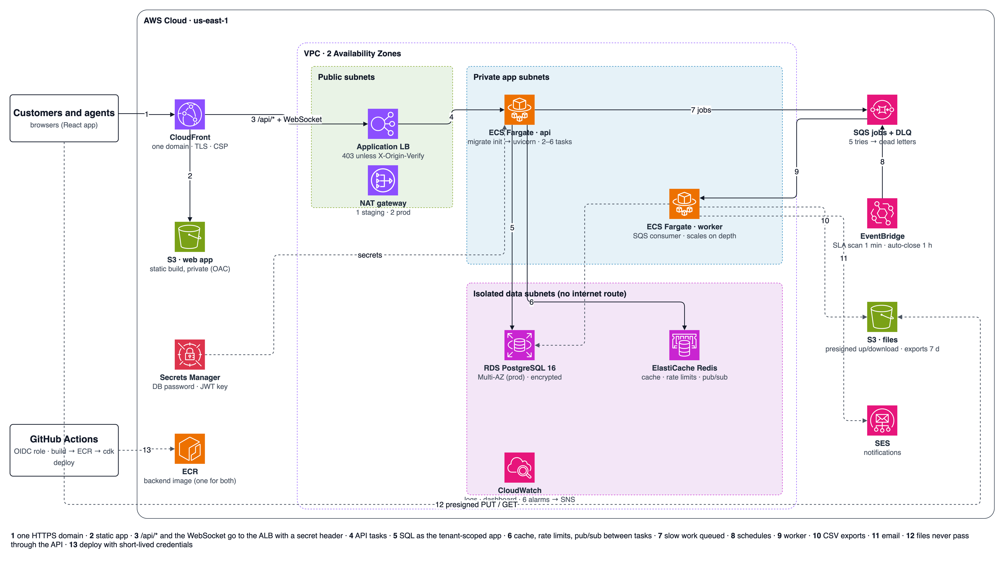
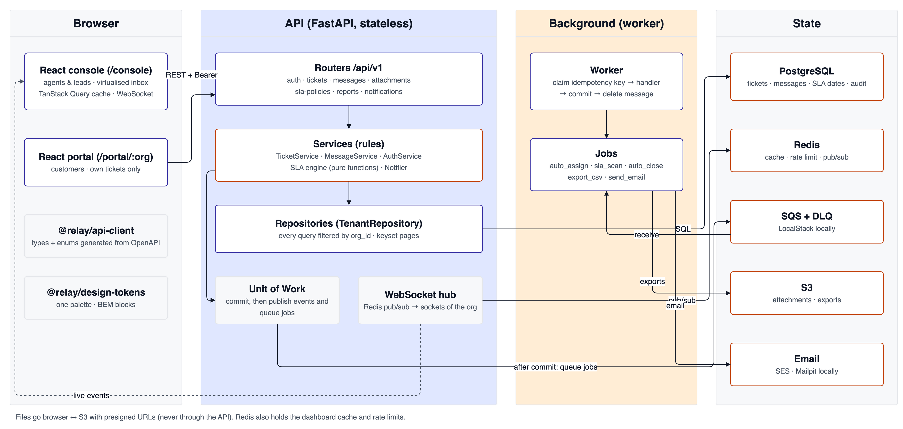

# Relay

**Customer support with SLAs that actually hold, for B2B software teams.**

Customers open requests in a portal. Agents work a live inbox in the console. Every ticket runs an SLA clock in **business hours** (time zone, weekends, holidays, paused while waiting on the customer), and breaches are caught by a background worker.

A production-style showcase for a *Senior Full Stack (Python · React · AWS)* role: scalable, high-performance, built end to end.



| Dashboard | Customer portal | Sign in |
|---|---|---|
|  |  |  |

---

## Contents
1. [Features](#features)
2. [Tech stack](#tech-stack)
3. [Architecture](#architecture)
4. [Run it locally](#run-it-locally)
5. [Tests, quality and performance](#tests-quality-and-performance)
6. [AWS](#aws)
7. [Project structure](#project-structure)
8. [API](#api)
9. [Design system](#design-system)
10. [Decisions and next steps](#decisions-and-next-steps)

---

## Features

| | Feature | Notes |
|---|---|---|
| 🔐 | Sign-in for agents and customers | JWT access token (15 min, kept in memory) + rotating refresh token in an httpOnly cookie. A reused refresh token revokes the whole session family. Login is rate-limited |
| 🏢 | Multi-tenant | Every query is scoped to the caller's organisation (`TenantRepository`). A ticket id from another organisation returns 404 |
| 📥 | Agent console | Views (My open, Unassigned, Breaching soon, All), filters, full-text search, four sort orders, virtualised infinite list, bulk assign/solve, keyboard `j`/`k`/`a`/`r` |
| 💬 | Ticket thread | Public replies and internal notes, canned replies with `{{customer.name}}`-style placeholders, "send and set status", attachments |
| ⚡ | Real time | Ticket changes, replies, SLA alerts and notifications arrive live over WebSocket. Redis pub/sub fans out across API tasks. Shows when another agent is typing |
| ⏱️ | SLA engine | First-response and resolution targets per priority, in business hours. Pauses on "waiting on customer". Warns 30 min before a deadline and flags a breach once |
| 🤖 | Automations | Round-robin auto-assign, SLA scan every minute, auto-close 4 days after solved, all as SQS jobs with idempotency keys |
| 📧 | Notifications | In-app list + email (SES in AWS, Mailpit locally) |
| 📎 | Files | Presigned S3 upload and download (25 MB, type allow-list). Files never pass through the API |
| 📊 | Dashboard | Open by status, open breaches, first-response median and p90, SLA attainment, 14-day volume, per-agent load (cached 30 s) |
| 📤 | CSV export | A background job streams the rows to S3, then the user gets a presigned link |
| 🧾 | Audit log | Who did what on each ticket |
| ⚙️ | Settings | SLA targets per priority, business hours and time zone, holidays, canned replies (owners and admins) |
| 🌐 | Customer portal | Sign up or sign in per organisation, open a request with attachments, follow the thread |

Demo data: 2 organisations (*acme* and *initech*, the second only to prove isolation), 4 agents, 120 customers, 5,000 tickets. `make seed-large` adds 1,000,000 more.

| Account (organisation `acme`) | Password | Role |
|---|---|---|
| `lead@acme.demo` | `Demo@1234` | owner |
| `agent@acme.demo` | `Demo@1234` | agent |
| `customer@globex.demo` | `Demo@1234` | customer (portal: `/portal/acme`) |

---

## Tech stack

| Layer | Choice |
|---|---|
| API | Python 3.12, **FastAPI** (async), Pydantic v2, SQLAlchemy 2 async + asyncpg, Alembic |
| Worker | Same codebase; SQS consumer with idempotent handlers, EventBridge schedules |
| Data | PostgreSQL 16 (full-text search, generated columns, partial indexes), Redis 7 (cache, rate limits, pub/sub) |
| Front end | **React 19** + TypeScript, Vite, TanStack Query, TanStack Virtual, React Router |
| Shared FE | `@relay/api-client` (types + enums generated from OpenAPI), `@relay/design-tokens` (one palette, BEM base) |
| Cloud | **AWS**: CloudFront, S3, ALB, ECS Fargate, RDS, ElastiCache, SQS + DLQ, EventBridge, SES, Secrets Manager, CloudWatch |
| IaC / CI | **AWS CDK (Python)** with assertion tests; GitHub Actions (CI + OIDC deploy) |
| Local AWS | Docker Compose: Postgres, Redis, **LocalStack** (SQS, S3), **Mailpit** (email) |
| Tests | pytest (unit + integration on real services), Vitest + Testing Library, Playwright, k6 |
| Quality | ruff, mypy --strict, ESLint, Stylelint (BEM), tsc, `alembic check` |

---

## Architecture





Key ideas:
- **Stateless API.** All state is in Postgres, Redis, SQS or S3, so tasks scale out freely. WebSocket events reach every task through Redis pub/sub.
- **Nothing slow in a request.** Email, assignment, SLA scans and exports are SQS jobs. Side effects run only **after commit** (Unit of Work), and each job claims an idempotency key in the same transaction as its effects.
- **One source of truth.** Python enums and schemas become TypeScript through OpenAPI, and CI fails on drift.
- **One domain.** CloudFront serves the app and proxies `/api/*` (including the WebSocket) to the ALB. The ALB refuses traffic without CloudFront's secret header.

Diagrams: [ERD](docs/architecture/erd.png) · [Ticket status and SLA clock](docs/architecture/ticket_lifecycle.png) ·
flows [B1 sign-in](docs/architecture/flow_b1_sign_in.png) · [B2 open a ticket](docs/architecture/flow_b2_open_ticket.png) ·
[B3 agent reply](docs/architecture/flow_b3_agent_reply.png) · [B4 real-time fan-out](docs/architecture/flow_b4_realtime.png) ·
[B5 SLA scan](docs/architecture/flow_b5_sla_scan.png) · [B6 CSV export](docs/architecture/flow_b6_csv_export.png) ·
[B7 tenant isolation](docs/architecture/flow_b7_tenant_isolation.png). Sources (`.drawio`) and the generator are in [`docs/architecture`](docs/architecture).

---

## Run it locally

Requirements: Docker, [uv](https://docs.astral.sh/uv/), Node 22+.

```bash
git clone https://github.com/deputychinh/Replay.git relay && cd relay
make install          # uv sync + npm install
make up               # Postgres :5442, Redis :6389, LocalStack :4566, Mailpit :8026
make migrate seed     # schema + demo data
make api              # terminal 1 → http://localhost:8030/docs
make worker           # terminal 2 → jobs + local schedules (SLA scan every minute)
make web              # terminal 3 → http://localhost:5190
```

Console: http://localhost:5190/login · Portal: http://localhost:5190/portal/acme · Emails: http://localhost:8026 · API docs: http://localhost:8030/docs

The ports are chosen to run beside other projects. `make up-full` also runs the API and worker as containers (API on :8020). `make help` lists every command.

---

## Tests, quality and performance

| Suite | Count | What it proves |
|---|---|---|
| Backend unit | 33 | SLA clock (overnight, weekends, holidays, DST, other zones), pause/resume/breach rules, status machine, round robin, every tenant table has a scoped repository, tokens |
| Backend integration (Postgres, Redis, LocalStack) | 24 | Login, refresh rotation and reuse detection, login rate limit; cross-tenant 404 on every ticket route; customers see only their tickets and never internal notes; the full ticket lifecycle; keyset pagination for every sort; presigned S3 upload/download; SLA scan breaches once with duplicate jobs skipped; CSV export to S3; WebSocket events reach only their organisation |
| Frontend (Vitest) | 18 | SLA display, formatting, canned reply placeholders, badges, thread rendering (incl. XSS) |
| E2E (Playwright) | 2 | Portal request → console reply → customer sees it; customers are refused in the console |
| Infrastructure (CDK assertions) | 18 | Private and encrypted DB, private buckets, DLQ, ALB origin lock, migrations before the API, schedules, CloudFront routing, alarms, OIDC trust limited to this repo (staging and prod) |
| Load (k6) | — | 1,005,000 tickets: **list p95 7.9 ms, detail p95 6 ms at 200 req/s; 11 ms at 800 req/s; 0 errors**. The fix that got there (4.9 s → 7.9 ms) is in [loadtest/README.md](loadtest/README.md) |

Backend coverage is about 92 %. `make lint` runs ruff, mypy --strict, ESLint, Stylelint and tsc. CI (`.github/workflows/ci.yml`) runs all of it, plus `alembic check`, the generated-client drift check, Playwright and `cdk synth`.

---

## AWS

Everything is in [`infra/cdk`](infra/cdk) (Python CDK, six stacks per stage):

| Stack | Contents |
|---|---|
| Network | VPC over 2 AZs: public, private app and isolated data subnets; NAT; S3 gateway endpoint |
| Data | RDS Postgres (Multi-AZ in prod, encrypted, backups), ElastiCache Redis, SQS + DLQ, EventBridge schedules, S3 files bucket (exports expire after 7 days), JWT and origin secrets |
| Services | ECR; ECS Fargate API (init container runs migrations, advisory-locked) behind an ALB with `/ready` health checks, autoscaling on CPU and requests; worker autoscaling on queue depth |
| Frontend | S3 + CloudFront (OAC), `/api/*` to the ALB, SPA fallback, security headers (CSP, HSTS …) |
| Observability | Dashboard; alarms for 5xx, p95 latency, dead letters, queue age, DB and API CPU → SNS; monthly budget |
| Ci | GitHub OIDC provider + deploy role trusted only by `deputychinh/Replay` |

```bash
make cdk-test     # assertion tests
make cdk-synth    # CloudFormation in infra/cdk/cdk.out
# deploy (needs an AWS account): cd infra/cdk && npx aws-cdk@2 deploy --all -c stage=staging -c imageTag=<sha> -c appUrl=https://…
```

`.github/workflows/deploy.yml` deploys staging on `main` and production on `v*` tags (with approval). It does nothing until the `AWS_ROLE_ARN` variable is set. Staging costs about **USD 110–120 a month** (see [ADR-0006](docs/adr/0006-aws-ecs-cloudfront-cdk.md)).

---

## Project structure

```
relay/
├── backend/
│   ├── app/
│   │   ├── common/        enums.py · constants.py · schemas.py   ← the single source
│   │   ├── core/          config · security · errors (one envelope) · logging · deps · aws
│   │   ├── db/            base · session · unit_of_work · tenant (TenantRepository)
│   │   ├── sla/           calendar · clock (pure) · policy
│   │   ├── cache/  realtime/  jobs/
│   │   ├── modules/       auth · users · organizations · teams · tickets · messages · attachments
│   │   │                  sla_policies · canned_replies · notifications · reports · automations
│   │   ├── main.py · worker.py · seed.py · openapi.py
│   ├── alembic/ · tests/{unit,integration} · Dockerfile
├── frontend/
│   ├── packages/api-client/      generated types + enums, typed client with silent refresh
│   ├── packages/design-tokens/   tokens.css (only file with colours) · base.css
│   ├── web/src/                  app/ · components/ (BEM blocks) · features/ · queries/ · lib/
│   └── e2e/
├── infra/cdk/                    app.py · relay_infra/*_stack.py · tests/
├── infra/localstack/init/        queues + bucket, same names as CDK
├── loadtest/                     k6 script + results
├── docs/                         plan.md · adr/ · architecture/ · screenshots/
├── docker-compose.yml · Makefile · .github/workflows/
```

---

## API

OpenAPI at `/docs`. All routes are under `/api/v1`, and errors use one envelope: `{ "error": { "code", "message", "details", "request_id" } }`.

| Area | Routes |
|---|---|
| Auth | `POST /auth/login` · `POST /auth/register` (customer) · `POST /auth/refresh` · `POST /auth/logout` · `GET /auth/me` |
| Tickets | `GET /tickets?view&status&priority&assignee_id&tag&q&sort&cursor&limit` · `POST /tickets` · `GET/PATCH /tickets/{id}` · `POST /tickets/bulk` · `GET /tickets/{id}/events` |
| Messages | `GET/POST /tickets/{id}/messages` |
| Files | `POST /attachments` (presigned PUT) · `GET /attachments/{id}` (presigned GET) |
| Settings | `GET /organization` · `GET/PUT /organization/calendar` · `POST /organization/holidays` · `GET /sla-policies` · `PUT /sla-policies/{priority}` · `GET/POST/DELETE /canned-replies` · `GET/POST /users/staff` |
| Reports | `GET /reports/dashboard` · `POST /reports/exports` (202) · `GET /reports/exports/{id}` |
| Other | `GET /notifications` · `POST /notifications/read` · `WS /ws` (first message: `{token}`) · `GET /health` · `GET /ready` |

---

## Design system

One palette for the whole product, in `frontend/packages/design-tokens/tokens.css`:

| Token | Hex | Use |
|---|---|---|
| ink-900 | `#111827` | text (16.7 : 1) |
| indigo-700 | `#3730A3` | **primary**: buttons, links, focus (9.4 : 1; white text 9.9 : 1) |
| signal-700 | `#C2410C` | **accent**: urgent, overdue, alerts (4.9 : 1) |
| slate-900 | `#0F172A` | console sidebar |
| green / amber / red / sky 700 | `#15803D` `#A16207` `#B91C1C` `#0369A1` | statuses (all ≥ 4.6 : 1) |

The CSS is BEM (`block__element--modifier`), with one block per file named after it and cascade layers `tokens → base → components → pages`. Stylelint enforces the BEM pattern and allows no raw colours outside the tokens file.

---

## Decisions and next steps

The full reasoning is in [docs/plan.md](docs/plan.md) (requirements → design standards → decisions; built vs. planned in §18) and the ADRs:
[0001 layers and tenant scope](docs/adr/0001-layered-fastapi-and-tenant-scope.md) ·
[0002 one React app](docs/adr/0002-one-react-app-two-areas.md) ·
[0003 generated client](docs/adr/0003-openapi-generated-client.md) ·
[0004 queue and after-commit](docs/adr/0004-queue-and-after-commit-side-effects.md) ·
[0005 SLA engine](docs/adr/0005-business-hours-sla-engine.md) ·
[0006 AWS](docs/adr/0006-aws-ecs-cloudfront-cdk.md)

Next steps:
- @mentions in internal notes.
- Customer sign-up limited to allowed email domains.
- Inbound email to ticket (SES receiving).
- A custom domain + ACM certificate, with HTTPS from CloudFront to the ALB, and WAF.
- AI reply suggestions and a knowledge base.
