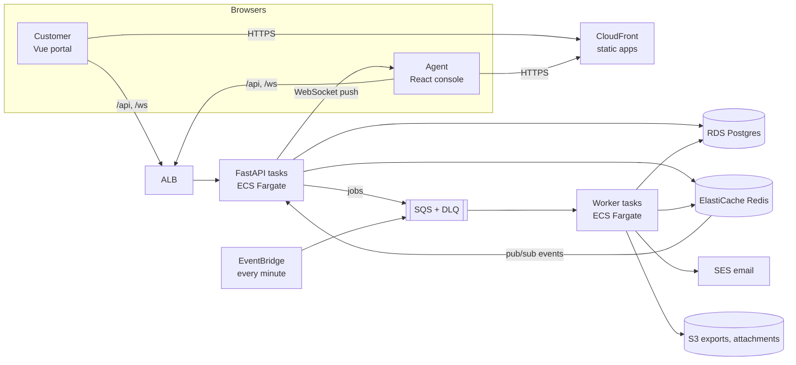

# Relay — Customer Support & SLA Platform — Project Plan

> A production-style showcase for the role: *"Senior Full Stack Developer — Python, React, Vue, AWS. Build and maintain scalable web applications, support application architecture, deliver reliable, high-performance solutions, end-to-end."*
>
> Backend: **Python 3.12 · FastAPI · SQLAlchemy 2 (async) · PostgreSQL · Redis · background worker on SQS**.
> Frontend: **React 19 + TypeScript**, one app with two areas — the agent **console** and the customer **portal** — using one design system and one generated API client.
> Cloud: **AWS** (ECS Fargate, RDS, ElastiCache, SQS, S3, CloudFront, SES, CloudWatch), infrastructure as code with **AWS CDK in Python**.
> Diagrams: **draw.io** (architecture, AWS deployment, ERD, ticket lifecycle, one sequence diagram per business flow).
>
> Status: **APPROVED 2026-10-08** (decisions in §17). React only (no Vue); AWS is code + local emulation (LocalStack), no live deploy. Repo: https://github.com/deputychinh/Replay

---

## 1. Goals

| What the job asks for | How this project shows it |
|---|---|
| Python back end | FastAPI, async SQLAlchemy, Alembic, Pydantic v2, pytest; a separate worker process for background jobs |
| React and Vue front ends | Two real apps for two audiences: **React** agent console (dense, real-time) and **Vue** customer portal (simple, public-facing) |
| AWS | Full deployment designed **and** scripted with CDK (Python): VPC, ECS Fargate, RDS, ElastiCache, SQS, S3 + CloudFront, SES, alarms, GitHub OIDC |
| Scalable, high-performance | Stateless API, Redis cache + rate limits, real-time updates over WebSocket with Redis pub/sub, slow work moved to an SQS queue, keyset pagination, load test with numbers |
| Support application architecture, drive technical decisions | Requirements → design standards → decisions (§2A), ADRs, diagrams, a written trade-off for every big choice |
| End-to-end delivery | Ticketed work breakdown, CI/CD, migrations, observability, runbook, demo |
| Collaboration, good English, U.S. timezone | Clear docs and PR descriptions; the SLA engine and timestamps are timezone-aware (business hours per team, e.g. America/New_York) |

**Main aim: simple, explicit code.** No magic strings: one home for each enum, constant and interface. Small modules with readable names. When two options work, the simpler one wins.

---

## 2. Product scope (MVP)

**Relay** is a help desk for B2B software companies. Customers raise tickets in a portal; support agents work queues in a console; every ticket has an SLA clock, and breaches are caught automatically.

### Personas
- **Customer (end user):** opens tickets, replies, sees status. Uses the **Vue portal**.
- **Agent:** works the queue, replies, adds internal notes, changes status and priority. Uses the **React console**.
- **Team lead / Admin:** manages team members, SLA policies, business hours and canned replies; watches dashboards.

### Features: in scope
| # | Feature | Notes |
|---|---|---|
| F1 | Auth for agents and customers | Email + password, JWT access + refresh (httpOnly cookie), roles |
| F2 | Multi-tenant organisations | Each software company is an organisation with its own agents, customers and settings |
| F3 | Customer portal (Vue) | Sign up via invite or allowed email domain, open a ticket, reply, attach files, see history |
| F4 | Agent console (React) | Views: My tickets, Unassigned, All, Breaching soon; filters; bulk assign; keyboard shortcuts |
| F5 | Ticket thread | Public replies and internal notes, attachments (S3 presigned upload), @mentions |
| F6 | Real-time updates | New tickets, replies and assignments appear live in the console (WebSocket); "someone is replying" presence |
| F7 | SLA engine | Policy per priority: first response and resolution targets in **business hours**; pause while waiting on the customer; breach warnings |
| F8 | Automations | On create: auto-assign by round robin within a team; on breach risk: notify; auto-close after N days solved |
| F9 | Notifications | Email via SES (local: Mailpit) on reply, assignment and breach; in-app notification list |
| F10 | Canned replies | Saved snippets with placeholders `{{customer.name}}` |
| F11 | Dashboard | Open by status, first-response time p50/p90, SLA attainment %, volume per day, per-agent load |
| F12 | CSV export | Large exports run in the worker and land in S3 with a download link |
| F13 | Audit log | Who changed what on each ticket |

### Out of scope (written as "next steps")
Live chat widget, AI reply suggestions, knowledge base, multi-language UI, SSO/SAML, mobile apps, billing.

---

## 2A. Requirements → design standards → decisions

### 2A.1 Functional requirements (FR)
| ID | Requirement | Actor | Priority |
|---|---|---|---|
| FR-01 | Sign in, sign out, refresh session; agents and customers have different apps and roles | All | Must |
| FR-02 | Data of one organisation is never visible to another | System | Must |
| FR-03 | Customer opens a ticket with subject, description, category and attachments | Customer | Must |
| FR-04 | Customer and agent exchange replies; agents add internal notes customers never see | Customer, Agent | Must |
| FR-05 | Agent lists tickets by view and filter (status, priority, assignee, team, tag, search), sorted and paginated | Agent | Must |
| FR-06 | Agent assigns, changes status and priority; bulk actions on many tickets | Agent | Must |
| FR-07 | Console updates live when tickets change | Agent | Must |
| FR-08 | Every ticket gets SLA targets from its priority; the clock counts business hours only and pauses on "waiting for customer" | System | Must |
| FR-09 | Tickets about to breach are flagged; breaches notify the assignee and the team lead | System | Must |
| FR-10 | New tickets are auto-assigned round robin within the team | System | Should |
| FR-11 | Email notifications for replies, assignment and breach | System | Should |
| FR-12 | Dashboard with response time, SLA attainment and volume | Lead | Should |
| FR-13 | Export tickets to CSV for a date range | Lead | Should |
| FR-14 | Canned replies with placeholders | Agent | Could |
| FR-15 | Audit log per ticket | Lead | Could |

### 2A.2 Non-functional requirements (NFR)
| ID | Quality | Requirement (measurable) |
|---|---|---|
| NFR-01 | Performance | API p95 < 200 ms for list/detail at 200 req/s on 2 small tasks; ticket list with 1 M tickets stays < 200 ms (indexes + keyset pagination); console first load < 2.5 s on 4G |
| NFR-02 | Scalability | API and worker are stateless and scale out by task count; WebSocket fan-out through Redis pub/sub works across tasks; slow jobs never run in the request |
| NFR-03 | Availability | 99.9 % target in production: 2+ tasks per service over 2 AZs, Multi-AZ RDS, health checks, rolling deploys |
| NFR-04 | Security | OWASP Top 10: bcrypt passwords, short-lived JWT + rotating refresh in httpOnly cookie, tenant filter on every query, role checks, validated input, rate limits, presigned S3 uploads with size/type limits, secrets only in Secrets Manager, private subnets for data |
| NFR-05 | Correctness | SLA maths is deterministic and unit-tested across time zones, DST changes and holidays; one transaction per use case; idempotent queue consumers |
| NFR-06 | Maintainability | Feature-first modules; one home per enum/constant/interface; ruff + mypy strict; ESLint + Stylelint (BEM); TS types generated from OpenAPI |
| NFR-07 | Testability | ≥ 85 % coverage on services and SLA engine; integration tests on real Postgres/Redis; Playwright E2E for both apps |
| NFR-08 | Observability | JSON logs with request id and org id, metrics (request latency, queue depth, SLA breaches), CloudWatch dashboard + alarms, `/health` and `/ready` |
| NFR-09 | Deployability | `make up` locally; one merge deploys staging; tag deploys production with approval; rollback < 5 min; everything as code |
| NFR-10 | Usability & a11y | WCAG 2.1 AA, full keyboard use in the console, responsive portal from 360 px |
| NFR-11 | Time zones | Store UTC; show in the viewer's zone; SLA business hours in the team's zone (default America/New_York) |
| NFR-12 | Cost | Staging ≈ USD 120/month on demand (§15.6), budget alarm, can be destroyed and recreated from code |

### 2A.3 Design standards (DS)
| ID | Rule every change must follow | From |
|---|---|---|
| DS-01 | **Layered back end:** router → service → repository → model. Routers hold no rules; services know nothing about HTTP | NFR-06, NFR-07 |
| DS-02 | **Single source of truth:** Python enums/constants/schemas in `app/common`; the OpenAPI spec generates TS types and enums into `packages/api-client`; React and Vue import only from there | NFR-06 |
| DS-03 | **Tenant isolation by construction:** every repository query goes through `TenantScope(org_id)`; a test fails if a model with `org_id` is queried without it | FR-02, NFR-04 |
| DS-04 | **Nothing slow in a request:** email, exports, SLA scans, webhooks go to SQS and the worker | NFR-01, NFR-02 |
| DS-05 | **Idempotent consumers:** every job carries an idempotency key stored in `processed_jobs` | NFR-05 |
| DS-06 | **Real time via one channel:** domain events → Redis pub/sub → WebSocket gateway; the event names are an enum | FR-07, NFR-02 |
| DS-07 | **Cache-aside with explicit keys and invalidation** built in one module | NFR-01 |
| DS-08 | **BEM + design tokens** shared by React and Vue from `packages/design-tokens`; no raw colours outside tokens | NFR-06, NFR-10 |
| DS-09 | **Simple names:** `format_duration`, `business_minutes_between`; no `utils.py`/`helpers.ts` grab-bags | NFR-06 |
| DS-10 | **Everything as code:** Docker, Alembic, CDK, CI/CD, diagrams | NFR-09 |
| DS-11 | **Test pyramid:** unit (services, SLA), integration (API on real Postgres/Redis), E2E (one journey per app), load test for NFR-01 | NFR-07 |

### 2A.4 Traceability: decision → why
| Decision | Why |
|---|---|
| FastAPI + async SQLAlchemy | Python requirement; async I/O for many concurrent WebSocket + API connections — NFR-01/02 |
| React for the console, Vue for the portal | Job lists both; each fits its audience (dense real-time app vs. light public portal); both share tokens and API client — DS-02, DS-08 |
| OpenAPI → generated TS client | One contract for three codebases — DS-02 |
| Postgres + Redis + SQS | Durable data, fast cache/pub-sub, reliable queue with DLQ — DS-04/06/07 |
| ECS Fargate over Lambda | Long-lived WebSockets and connection pools; same Docker images locally and in AWS — NFR-02/09 |
| CDK in Python | Infra in the same language as the back end; typed, testable — DS-10 |
| Business-hours SLA engine as pure functions | Deterministic, unit-testable — NFR-05/11 |
| Keyset pagination + composite indexes | Lists stay fast at 1 M rows — NFR-01 |

---

## 3. Tech stack
| Layer | Choice | Why |
|---|---|---|
| API | Python 3.12, FastAPI, Uvicorn (uvloop), Pydantic v2 | Typed, async, OpenAPI for free |
| ORM / migrations | SQLAlchemy 2.0 async + asyncpg, Alembic | Typed models, versioned schema |
| DB | PostgreSQL 16 (RDS) | Relational data, full-text search (`tsvector`) for tickets |
| Cache / pub-sub / rate limit | Redis 7 (ElastiCache) | Speed, fan-out for WebSockets |
| Queue / worker | SQS + DLQ; worker = Python process using the same services | Reliable background jobs; scheduler via EventBridge (SLA scan every minute) |
| Files | S3 presigned uploads, CloudFront signed downloads | Large files never pass through the API |
| Email | SES (local: Mailpit) | |
| Agent console | React 19, TypeScript, Vite, TanStack Query, React Router | Server-state caching, fast lists |
| Customer portal | Vue 3 `<script setup lang="ts">`, Vite, Pinia, Vue Router | Small and simple |
| Shared FE | `packages/api-client` (generated from OpenAPI: types, enums, fetch client), `packages/design-tokens` (CSS variables + BEM base) | One source for both apps |
| Styling | SCSS with BEM + tokens, no UI kit | Full control, one brand |
| Tests | pytest, pytest-asyncio, httpx, factory-boy; Vitest + Testing Library (React) / Vue Test Utils; Playwright; k6 (load) | |
| Quality | ruff, mypy --strict, ESLint, Stylelint (BEM), tsc / vue-tsc, pre-commit | |
| Infra | Docker, docker-compose, AWS CDK (Python), GitHub Actions with OIDC | |
| Diagrams | draw.io generated by Python scripts, exported to PNG | Same as the previous projects |

---

## 4. Architecture



**Rules**
- Front ends are static files on S3 + CloudFront; the API and WebSocket gateway are the same FastAPI service behind an ALB.
- Every state change publishes a domain event (`TicketCreated`, `ReplyAdded`, `TicketAssigned`, `SlaBreached` …) to Redis; each API task forwards the events to its connected sockets for that organisation.
- Anything slow or retryable becomes an SQS job processed by the worker; jobs are idempotent.

---

## 5. Repository layout
```
relay/
├── README.md
├── Makefile                       # make up / down / test / lint / migrate / seed / gen-client / diagrams / deploy
├── docker-compose.yml             # postgres, redis, localstack (sqs, s3), mailpit, api, worker, console, portal
├── .github/workflows/             # ci.yml, deploy.yml
├── backend/                       # FastAPI app + worker (§6)
├── frontend/
│   ├── console/                   # React agent console (§7)
│   ├── portal/                    # Vue customer portal (§8)
│   └── packages/
│       ├── api-client/            # generated from OpenAPI: types, enums, client
│       └── design-tokens/         # tokens.css, base.css, BEM blocks shared by both apps
├── infra/cdk/                     # AWS CDK app in Python (§15)
├── loadtest/                      # k6 scripts + results
└── docs/
    ├── plan.md                    # this file
    ├── adr/
    ├── architecture/              # gen_diagrams.py, *.drawio, *.png
    └── screenshots/
```

---

## 6. Backend design (FastAPI)

### 6.1 Folder structure
```
backend/app/
├── main.py                       # create_app(): routers, middleware, WebSocket route
├── worker.py                     # SQS consumer loop → job handlers
├── core/        config.py, security.py, logging.py, middleware.py (request id, timing), errors.py
├── common/      enums.py, constants.py, schemas.py (Page[T], ApiError), events.py (event names)
├── db/          base.py (mixins), session.py, unit_of_work.py, tenant_scope.py
├── cache/       redis.py, keys.py, cache.py, rate_limit.py
├── realtime/    hub.py (connections per org), publisher.py (Redis publish), gateway.py (WS route)
├── jobs/        queue.py (SQS send), registry.py (job type → handler), idempotency.py
├── sla/         calendar.py (business hours, holidays), clock.py (pure SLA maths), policy.py
└── modules/
    ├── auth/          router, service, schemas
    ├── organizations/ router, service, repository, models, schemas
    ├── users/         … (agents, customers, roles)
    ├── teams/         …
    ├── tickets/       router, service, repository, models, schemas, filters.py, search.py
    ├── messages/      … (replies, internal notes)
    ├── attachments/   … (presigned upload/download)
    ├── sla_policies/  …
    ├── automations/   service (round robin, auto-close), handlers (jobs)
    ├── notifications/ service, email templates, handlers
    ├── canned_replies/…
    ├── reports/       dashboard queries, CSV export handler
    └── audit/         …
```

### 6.2 Patterns (each with a reason)
| Pattern | Where | Why |
|---|---|---|
| Layered | router → service → repository | Rules testable without HTTP/DB |
| Repository + TenantScope | `db/tenant_scope.py` | Tenant filter cannot be forgotten (DS-03) |
| Unit of Work | `db/unit_of_work.py` | One transaction per use case; events published **after** commit |
| Domain events + pub/sub | `common/events.py`, `realtime/` | Real-time without coupling services to sockets |
| Command queue + idempotency | `jobs/` | Reliable background work, safe retries |
| Strategy | assignment (`RoundRobin`, `LeastLoaded`), notifier (`SesNotifier`, `ConsoleNotifier`) | Swap behaviour without touching callers |
| Specification | `tickets/filters.py` | Composable list filters |
| Pure functions | `sla/clock.py` | SLA maths is deterministic and easy to test |
| Generic types | `Page[T]`, `CursorPage[T]` | One response shape |

### 6.3 Enums (`app/common/enums.py`) — the single source
```python
class Role(StrEnum):            OWNER, ADMIN, AGENT, CUSTOMER
class TicketStatus(StrEnum):    NEW, OPEN, PENDING_CUSTOMER, ON_HOLD, SOLVED, CLOSED
class TicketPriority(StrEnum):  LOW, NORMAL, HIGH, URGENT
class TicketChannel(StrEnum):   PORTAL, EMAIL, API
class MessageKind(StrEnum):     PUBLIC_REPLY, INTERNAL_NOTE
class SlaTarget(StrEnum):       FIRST_RESPONSE, RESOLUTION
class SlaState(StrEnum):        ACTIVE, PAUSED, MET, BREACHED
class TicketView(StrEnum):      MINE, UNASSIGNED, ALL, BREACHING_SOON
class TicketSort(StrEnum):      NEWEST, OLDEST, PRIORITY, SLA_DUE
class JobType(StrEnum):         SEND_EMAIL, SLA_SCAN, AUTO_CLOSE, EXPORT_CSV, AUTO_ASSIGN
class EventName(StrEnum):       TICKET_CREATED, TICKET_UPDATED, REPLY_ADDED, TICKET_ASSIGNED, SLA_WARNING, SLA_BREACHED, AGENT_TYPING
class ErrorCode(StrEnum):       VALIDATION_ERROR, UNAUTHORIZED, FORBIDDEN, NOT_FOUND, CONFLICT, INVALID_TRANSITION, RATE_LIMITED, INTERNAL_ERROR
```
They reach React and Vue through OpenAPI (`openapi-typescript` + a small script that turns enum schemas into `as const` objects in `packages/api-client`). CI fails if the generated client is out of date.

### 6.4 Constants (`app/common/constants.py`)
Page sizes, JWT TTLs, rate limits, upload limits (25 MB, allowed MIME types), cache TTLs, SLA warning window (e.g. 30 min before breach), auto-close days, WebSocket heartbeat — all here, never inline.

### 6.5 Ticket status machine
`NEW → OPEN → PENDING_CUSTOMER ⇄ OPEN → SOLVED → CLOSED`, plus `ON_HOLD`. A customer reply on `PENDING_CUSTOMER` or `SOLVED` reopens to `OPEN`. `CLOSED` is final. The allowed moves live in one `TICKET_TRANSITIONS` table; the console reads them from the API to show buttons.

### 6.6 SLA engine
- Policy per organisation and priority: first-response minutes, resolution minutes, business-hours flag.
- Calendar per team: weekly hours, time zone, holidays.
- `clock.py`: `business_minutes_between(start, end, calendar)` and `due_at(start, minutes, calendar)`; pauses are intervals subtracted from elapsed time.
- Stored on the ticket: `first_response_due_at`, `resolution_due_at`, `sla_state`; recomputed on status change. A scan job every minute (EventBridge → SQS) emits `SLA_WARNING` / `SLA_BREACHED` once (idempotency key = ticket + target + kind).

### 6.7 Data model (Postgres)
`organizations`, `users` (role, org), `teams`, `team_members`, `business_calendars`, `holidays`, `sla_policies`, `tickets` (status, priority, requester, assignee, team, due dates, sla_state, search tsvector), `messages` (kind, body, author), `attachments` (s3 key, size, mime), `tags`, `ticket_tags`, `canned_replies`, `notifications`, `audit_events`, `processed_jobs`, `refresh_tokens`.
Indexes: `(org_id, status, updated_at desc, id)` for keyset lists, `(org_id, assignee_id, status)`, `(org_id, resolution_due_at) where sla_state = 'active'`, GIN on `search`.

### 6.8 API (`/api/v1`) — main routes
Auth (login, refresh, logout, me) · organisations/settings · users & invites · teams · tickets (list with view/filter/cursor, create, get, patch, bulk) · messages (list, create reply/note) · attachments (presign upload, download link) · SLA policies & calendars · canned replies · notifications · dashboard · exports (start, status) · `/ws` WebSocket · `/health`, `/ready`.
Errors: one envelope `{ error: { code, message, details, request_id } }`.

### 6.9 Backend testing
Unit: services with fake repositories, SLA clock (DST, holidays, pauses — table-driven). Integration: API against Postgres/Redis/LocalStack in Docker, tenant isolation test for every endpoint, queue handlers idempotency. Load: k6 scenario (list + detail + reply) reporting p95.

---

## 7. Agent console (React)
- **Structure:** feature folders `features/tickets`, `features/ticket-detail`, `features/dashboard`, `features/settings`; `app/` (router, providers, query client); `components/` (BEM blocks: `button`, `field`, `table`, `badge`, `avatar`, `sla-timer`, `command-palette`, `toast`, `modal`); `realtime/` (WebSocket hook that updates TanStack Query caches).
- **Screens:** inbox with views and filters (URL is the state), split view ticket detail (thread, composer with canned replies, side panel with SLA timers and properties), dashboard (charts), settings (team, SLA policies, business hours, canned replies).
- **Performance:** virtualised ticket list, optimistic updates, query caching, code-split routes.
- **Keyboard:** `j/k` move, `a` assign to me, `r` reply, `⌘K` command palette.

## 8. Customer portal (Vue)
- **Structure:** `views/` (sign in, my tickets, new ticket, ticket thread), `components/` (BEM blocks shared names with the console), `stores/` (Pinia: session), `composables/` (`useTicket`, `useUpload`).
- Simple, fast, accessible; branded per organisation (logo + accent colour from settings).

## 9. Design system (shared by React and Vue)
**Brand idea:** calm and trustworthy, with one bright "signal" colour for urgency.

| Token | Hex | Use | Contrast |
|---|---|---|---|
| `--brand-ink-900` | `#111827` | text | 16.7 : 1 on bg |
| `--brand-indigo-700` | `#3730A3` | **primary** buttons, links, focus | 9.4 : 1; white text 9.9 : 1 |
| `--brand-indigo-600` | `#4338CA` | primary hover | 7.4 : 1 |
| `--brand-signal-700` | `#C2410C` | **accent**: urgent, SLA warning, highlights | 4.9 : 1; white text 5.2 : 1 |
| `--brand-slate-900` | `#0F172A` | console sidebar | white text 17.9 : 1 |
| `--brand-bg` | `#F7F8FA` | app background | — |
| `--brand-gray-600` | `#4B5563` | muted text | 7.1 : 1 |
| green / amber / red / sky 700 | `#15803D` `#A16207` `#B91C1C` `#0369A1` | status colours | all ≥ 4.6 : 1 |

Two token levels (palette → semantic) in `packages/design-tokens/tokens.css`; BEM blocks with the same names in both apps; Stylelint enforces BEM and "no raw colours".

---

## 10. Business flows (sequence diagrams, draw.io)
| Flow | Requirements | Key rules shown |
|---|---|---|
| B1 Sign in and refresh | FR-01, NFR-04 | 15-min access JWT, rotating refresh cookie, reuse detection revokes the family |
| B2 Customer opens a ticket | FR-03, FR-08, FR-10 | Presigned S3 upload, SLA due dates set, auto-assign job, `TICKET_CREATED` pushed live |
| B3 Agent replies | FR-04, FR-07, FR-11 | Status → PENDING_CUSTOMER pauses SLA, email job, live update to other agents |
| B4 Real-time fan-out | FR-07, NFR-02 | Event published after commit → Redis → every API task → sockets of that org only |
| B5 SLA scan and breach | FR-08, FR-09 | EventBridge → SQS → worker; warning once, breach once (idempotency); notify assignee + lead |
| B6 CSV export | FR-13, NFR-01 | Request returns 202 + job id; worker streams rows to S3; signed link; notification |
| B7 Tenant isolation | FR-02 | Org from JWT → TenantScope → every query; cross-tenant id returns 404 |

---

## 11. Diagrams (draw.io)
`architecture.drawio` (logical), `aws_deployment.drawio` (official AWS icons: VPC, subnets, ALB, ECS, RDS, ElastiCache, SQS, S3, CloudFront, SES, EventBridge, CloudWatch), `backend_modules.drawio`, `frontend_apps.drawio` (React + Vue + shared packages), `erd.drawio`, `ticket_lifecycle.drawio`, `sla_clock.drawio` (business hours + pause example), `business_flows.drawio` (B1–B7). Generated by `docs/architecture/gen_diagrams.py`; `make diagrams` exports PNGs.

---

## 12. Local development
```bash
cp .env.example .env
make up          # postgres, redis, localstack (SQS/S3), mailpit, api, worker, console :5173, portal :5174
make migrate seed
make test        # backend + console + portal
make lint
make e2e
make load        # k6 against the local stack
```
Demo accounts: `lead@acme.demo`, `agent@acme.demo`, `customer@globex.demo` / `Demo@1234`. Seed: 2 organisations, 3 teams, 5,000 tickets (and a `seed --large` option with 1 M tickets for the performance check).

---

## 13. Code conventions
- Python: ruff + mypy strict, type hints everywhere, `snake_case`, services raise `AppError` subclasses only.
- TS: strict, no `any`, generated types only — never hand-written API shapes.
- **One home per thing:** enum → `common/enums.py`; constant → `common/constants.py`; API shape → Pydantic schema → generated TS; UI text → `copy.ts` per app; colour → `tokens.css`.
- Utils: a name says what it does; no `utils.py`, `helpers.ts`, `misc`.
- Conventional Commits, one ticket per PR, "AI-assisted" note in the PR template.

---

## 14. Work breakdown (tickets)
- **Phase 0 (Day 1):** monorepo, Docker Compose, Makefile, lint/type configs, CI skeleton.
- **Phase 1 (Days 2–3):** models + Alembic, tenant scope, auth (JWT + refresh rotation), users/teams/orgs, seed. *AC: cross-tenant test suite green.*
- **Phase 2 (Days 4–5):** tickets, messages, attachments (LocalStack S3), filters, keyset pagination, search. *AC: list p95 < 200 ms on 1 M rows locally.*
- **Phase 3 (Day 6):** SLA engine (pure functions + tests), policies, calendars, scan job. *AC: DST and holiday tests pass.*
- **Phase 4 (Day 7):** worker, SQS jobs, idempotency, email (Mailpit), auto-assign, auto-close, CSV export.
- **Phase 5 (Day 8):** real-time: Redis pub/sub + WebSocket gateway + presence. *AC: two API processes, one event reaches sockets on both.*
- **Phase 6 (Days 9–11):** React console (inbox, detail, composer, dashboard, settings, shortcuts).
- **Phase 7 (Days 12–13):** Vue portal (sign in, tickets, new ticket with upload, thread).
- **Phase 8 (Day 14):** E2E for both apps, k6 load test with results, accessibility pass.
- **Phase 9 (Days 15–16):** AWS CDK stacks, deploy workflow with OIDC, alarms, runbook. *AC: `cdk synth` clean; `cdk deploy` to a staging account (if an account is provided).*
- **Phase 10 (Day 17):** diagrams, ADRs, README, screenshots, demo video.

---

## 15. AWS deployment (region us-east-1, U.S. timezone users)
### 15.1 Target
CloudFront (two distributions: console, portal) → S3 static; ALB → ECS Fargate `api` (2–6 tasks, autoscale on CPU and requests) and `worker` (1–4 tasks, autoscale on SQS queue depth); RDS Postgres Multi-AZ (staging single-AZ); ElastiCache Redis; SQS + DLQ; EventBridge schedule; SES; S3 for attachments and exports; Secrets Manager; CloudWatch logs, dashboard and alarms; WAF on CloudFront/ALB.
### 15.2 Network & security
VPC with public (ALB, NAT) and private app/data subnets across 2 AZs; security groups only allow ALB → API, API/worker → RDS/Redis; no public DB; TLS everywhere (ACM).
### 15.3 CDK stacks (Python)
`NetworkStack`, `DataStack` (RDS, Redis, S3, SQS), `ServicesStack` (ECS cluster, api + worker services, ALB, autoscaling), `FrontendStack` (S3 + CloudFront ×2), `ObservabilityStack` (dashboard, alarms, budget), `CiStack` (GitHub OIDC role). CDK assertions tests for each stack.
### 15.4 CI/CD
PR: lint, types, tests, client-generation check, Docker build. Merge to `main`: build + push images to ECR, run migrations as a one-off ECS task, deploy staging, smoke test. Tag `v*`: same for production after manual approval. Rollback = previous task definition.
### 15.5 Observability
Structured logs, request and queue metrics, alarms (5xx rate, p95 latency, DLQ > 0, queue age, CPU, DB connections), SLA breach metric per org.
### 15.6 Cost (staging, on demand, estimate)
Fargate 2×0.25 vCPU ≈ $18, RDS db.t4g.micro ≈ $15, ElastiCache t4g.micro ≈ $12, NAT gateway ≈ $33, ALB ≈ $18, CloudFront/S3/SQS/SES/CloudWatch ≈ $15 → **≈ $110–120 / month**; a "budget mode" without NAT (VPC endpoints) is documented.

---

## 16. Definition of Done & deliverables
**Per ticket:** AC met, tests added and green, ruff/mypy/ESLint/Stylelint/tsc clean, no new enum/constant/colour outside its home, docs/diagram updated if architecture changed.
**Deliverables:** Git repo with clean history · README (pitch, screenshots, architecture, setup, decisions) · OpenAPI docs at `/docs` · ADRs · draw.io diagrams + PNGs · k6 load-test report · test & coverage report · CDK app + runbook · short demo video.

---

## 17. Risks and open questions
### Risks
| Risk | Mitigation |
|---|---|
| Scope is large (two front ends + worker + infra) | Strict MVP; console first, portal second; automations limited to round robin + auto-close |
| SLA maths edge cases (DST, holidays) | Pure functions, table-driven tests, `zoneinfo` only |
| WebSocket scaling across tasks | Redis pub/sub fan-out, sticky sessions not required; tested with two processes locally |
| AWS cost while the demo is live | Staging minimal, budget alarm, `cdk destroy` after demos |
| No AWS account available | Everything still runs locally (LocalStack for SQS/S3); `cdk synth` output + diagrams prove the design |

### Decisions (answered 2026-10-08)
| # | Question | Decision |
|---|---|---|
| 1 | Product | Relay, customer support & SLA platform |
| 2 | Front ends | **React only.** The Vue portal becomes the `/portal` area of the same React app (separate layout, routes and role guard) |
| 3 | AWS | Write the CDK app and run the AWS services locally with LocalStack (SQS, S3) + Mailpit (SES). No live deploy; `cdk synth` + assertion tests prove the stacks |
| 4 | IaC | AWS CDK in Python |
| 5 | Brand | Relay, indigo + signal orange (§9) |
| 6 | Repo | `relay/` here, pushed to https://github.com/deputychinh/Replay |

---

## 18. Implementation notes (built vs. planned)

Built on 2026-10-08. Everything in §2 is done except where marked below. Where the code differs from the plan, the code wins and the reason is given here.

| Area | Plan | Built | Why |
|---|---|---|---|
| Front ends | React console + Vue portal | One React app with `/console` and `/portal/:org` areas | Decision §17 (React only) |
| Shared FE packages | api-client + design-tokens | Same; api-client uses openapi-typescript + openapi-fetch, enums generated as `as const` | One contract (ADR-0003) |
| Styling | SCSS + BEM | Plain CSS + BEM + cascade layers, checked by Stylelint | Modern CSS covers what SCSS was for; one less build step |
| Tenant isolation | TenantScope | `TenantRepository.scoped()`, a unit test that every tenant table has one, a cross-tenant 404 test | ADR-0001 |
| SLA | Pure functions | Same, plus a generated `sla_due_at` column with its own index | Load test showed the OR filter could not use an index |
| List performance | Composite indexes | One index per sort order + partial index for unassigned; "Breaching soon" always sorted by deadline | k6: list p95 from 4.9 s to 7.9 ms on 1M tickets (loadtest/README.md) |
| Migrations in AWS | One-off ECS task | Init container before the API, with an advisory lock in Alembic | No extra pipeline step; safe with many tasks (ADR-0006) |
| ALB exposure | WAF | ALB rejects requests without CloudFront's secret header; WAF left as a next step | Simple and free; WAF costs per rule |
| AWS | Deploy staging if an account exists | CDK app (6 stacks), 18 assertion tests, `cdk synth` in CI, deploy workflow ready (runs once `AWS_ROLE_ARN` is set); LocalStack + Mailpit locally | Decision §17 (code + local emulation only) |
| Presence | "someone is replying" | Agent typing events over the same WebSocket | Done |
| Mentions | @mentions | **Not built** | Next step |
| Customer sign-up | Invite or email domain | Open sign-up per organisation slug | Simpler for the demo; domain allow-list is a next step |

### Verification (2026-10-08)
- Backend: 57 tests (33 unit, 24 integration against Postgres, Redis and LocalStack in Docker), about 92 % coverage; ruff, mypy --strict and `alembic check` clean.
- Frontend: 18 Vitest tests (SLA display, formatting, placeholders, badges, the thread including an XSS case); ESLint, Stylelint (BEM) and tsc clean; initial JS 111 KB gzip, other routes lazy.
- E2E: 2 Playwright tests (portal request → console reply → customer sees it; a customer is refused in the console).
- Infrastructure: 18 CDK assertion tests (staging and prod), `cdk synth` of 6 stacks.
- Load: 200 req/s → list p95 7.9 ms, detail p95 6 ms; 800 req/s → 11 ms, 0 errors (1,005,000 tickets, laptop).
- Checked by hand in Chrome: console, dashboard, settings, portal.
